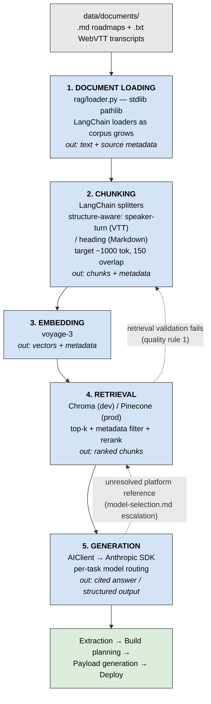

# RAG Architecture — Meeting-to-Workflow Builder

**Project:** Capstone AI — reads Fathom meeting transcripts and auto-deploys Make scenarios, MailerLite lists, and WordPress plugins/webhooks
**Status:** Design document. `src/capstone_ai/rag/` currently contains only `loader.py`; stages 2–5 are not yet implemented.
**Related:** [model-selection.md](model-selection.md) defines which model serves each pipeline task and why — read it before wiring generation.

---

## 1. System Diagram

The dotted edges are feedback paths, not the happy path. They exist because this pipeline's output is executable code deployed to live client systems — a bad retrieval must be caught and re-run, not passed downstream.

---

## 2. Component Decisions

### Stage 1 — Document Loading

**Choice:** Python stdlib `pathlib` today ([`rag/loader.py`](../src/capstone_ai/rag/loader.py)); LangChain document loaders as formats broaden.

**Formats:** `.md` (curated roadmaps, written by hand after a call) and `.txt` (raw WebVTT Fathom exports). Per the Production Constraints in CLAUDE.md, ingestion of uploaded files must additionally cap size at 50MB and validate MIME type against the whitelist (`application/pdf`, `.docx`, `text/plain`) before any of this runs.

**Justification:** The current corpus is five local files in two trivially-parsed text formats, so stdlib reading is sufficient and keeps the stage dependency-free and fast to test; LangChain earns its place once PDF and `.docx` uploads arrive, which the file-upload constraint already anticipates.

### Stage 2 — Chunking

**Choice:** Structure-aware splitting, dispatched by source format, targeting **~1000 tokens with ~150 token overlap**.

- **WebVTT transcripts** → merge consecutive cues from the same speaker into one turn, strip timestamps out of the body and into metadata, then pack turns up to the target size without splitting a turn.
- **Markdown roadmaps** → split on heading boundaries (`##`/`###`), since these documents are already authored in semantically complete sections.

**Justification:** Fixed-size character chunking is actively harmful on the transcripts — a naive split slices mid-exchange and leaves each chunk padded with timestamps and filler (`"Um, okay, so just to be clear…"`), diluting the embedding signal that retrieval depends on. The 1000-token target is large enough to hold a complete requirement plus its surrounding qualification, and the overlap is a hedge against the boundary failure described in §5.

**Status:** This is an *initial* strategy, not a validated one. Chunk size and overlap should be tuned against the `tests/eval/` harness once it exists.

### Stage 3 — Embedding

**Choice:** `voyage-3`.

**Justification:** It is Anthropic's recommended embedding provider (Anthropic ships no first-party embedding endpoint), it handles the long, low-information-density spans typical of conversational transcripts well, and staying close to the recommended stack keeps the embedding and generation halves of the pipeline coherent. Its API key is loaded through `Settings` like every other credential — never hardcoded.

**Note:** The embedding model is a hard migration boundary. Changing it invalidates every stored vector and forces a full corpus re-index, so it should be pinned explicitly in config rather than defaulted implicitly.

### Stage 4 — Vector Store

**Choice:** **Chroma** in development, **Pinecone** in production. `pinecone_api_key` already exists on `Settings` in [`core/config.py`](../src/capstone_ai/core/config.py).

**Why both:** Chroma runs in-process with no network calls, no account, and no cost, which is what makes the "every pipeline stage must be independently testable" quality rule practical — a retrieval test can build a throwaway index in a fixture and assert against it. Pinecone is a managed service that survives container restarts, which matters because production deploys to ephemeral AWS ECS containers where a local on-disk index would be lost on every task replacement.

The cost of running both is a single storage interface that each backend implements; the stages above and below the vector store should not know which one is active.

### Stage 5 — Generation

**Choice:** Anthropic Claude via the existing `AIClient` wrapper — **not** a direct SDK client, per the architecture rule in CLAUDE.md.

**Model routing is per-task, not global.** [model-selection.md](model-selection.md) assigns models by task shape with experimental rationale; the short version:

| Task | Model | One-line rationale |
|---|---|---|
| Extraction | `claude-sonnet-5` | Transcripts require inferring implicit intent; cheap-tier models failed inference-shaped tasks in Exp. 1 |
| Build planning | `claude-opus-4-8` | Multi-entity state tracking — the sharpest cross-provider gap in Exp. 3; runs once per build, so premium cost is proportionate |
| Payload generation | `claude-sonnet-5` | Least-evidenced choice in that doc; backstopped by mandatory pre-deployment validation |
| Error recovery | `gemini-3.5-flash-lite` | Classification-shaped; all cheap-tier models solved this in Exp. 2, Gemini was fastest |
| Verification summary | `gemini-3.5-flash-lite` | Won outright on short constrained writing in Exp. 4 |

`AIClient.extract_structured` is the right call shape for extraction — it forces a single tool call and validates the result into a Pydantic model, so a malformed structure fails loudly at the stage boundary rather than propagating.

---

## 3. Data Flow

What enters and exits each stage:

| Stage | In | Out |
|---|---|---|
| 1. Loading | File paths in `data/documents/` | `(path, raw_text)` pairs + source metadata (filename, format, client) |
| 2. Chunking | Raw text + source metadata | Chunks + inherited metadata, enriched with position, speaker, timestamp span, heading path |
| 3. Embedding | Chunk text | Dense vectors, each paired with its chunk's metadata and a stable chunk ID |
| 4. Retrieval | Query text + metadata filter | Ranked chunks with similarity scores and full provenance |
| 5. Generation | Ranked chunks + task prompt | Cited answer or validated structured output |

**Metadata is the through-line.** It is attached at stage 1 and must survive to stage 5 intact — if a chunk arrives at generation without knowing which meeting and which client it came from, the citation cannot be produced and a cross-client contamination bug becomes invisible. Concretely: the `client` field is what prevents an Ad Infinitum build from retrieving OurKehila context.

**Logging obligation.** Per the quality rules, each stage logs chunk counts and token usage. Per the production logging constraint, that logging is structured (structlog) with request/correlation IDs and must never emit document content or PII — log the count and the token total, not the chunk text.

---

## 4. Scale Considerations

**Current corpus:** 5 documents, ~127KB total (~32K tokens). The largest single document is 69KB (~17K tokens).

**At 10x (~50 documents, ~1.3MB):** still small. A full re-index is minutes of work and a few cents of embedding cost. Retrieval latency over ~1,300 chunks is negligible in both Chroma and Pinecone. **No component is meaningfully stressed at this size.**

**The bottleneck is not throughput — it is retrieval precision.** As the corpus grows, the number of chunks that are *plausibly* similar to any query grows with it. Ten meetings about WordPress builds means ten near-identical discussions of imprint colors and tiered pricing; a top-k retrieval that was unambiguous at 5 documents starts returning the right *kind* of chunk from the wrong *client*. This degrades quietly — retrieval still returns confident, well-scored, topically-correct results that are wrong for the build at hand.

**Mitigations, in order of what to reach for first:**

1. **Metadata filtering before similarity** — constrain by client and document before ranking. This is the highest-leverage change and is cheap.
2. **Reranking** the top-k with a cross-encoder, to recover cases where the qualifying statement scores lower than the initial statement.
3. **Per-stage indices** — payload generation retrieves platform API/schema docs, a fundamentally different corpus from meeting transcripts. These should not share an index, and at scale the schema corpus will dwarf the meeting corpus.

**A note on the current scale.** At 32K tokens total, the entire corpus fits in a single Claude context window. For the extraction stage specifically, passing a full transcript directly yields 100% recall by construction and removes the chunk-boundary failure mode entirely. This is in tension with the "do not skip the embedding step" constraint in CLAUDE.md — that rule is well-founded for payload generation against a large schema corpus, and the tension at extraction scale is worth resolving deliberately rather than by default. Recommend measuring extraction quality both ways against the 69KB document before committing.

---

## 5. Failure Modes

### 5.1 Retrieval miss (false negative)

Top-k returns chunks that are topically relevant but omit the one chunk containing the actual requirement. Generation then produces a confident, fluent, *incomplete* build plan — a Make scenario silently missing a step.

**Why it is the worst one here:** there is no error. The output looks correct and deploys successfully. Unlike a Q&A system where a user notices a non-answer, this pipeline's consumer is a deployment step that executes whatever it is handed.

**Mitigation:** retrieval validation before generation (quality rule 1) — assert that retrieved chunks actually cover the entities named in the query, and fail loudly rather than proceeding on thin coverage. Raise `k` and rerank rather than trusting a tight top-3.

### 5.2 Chunk boundary splits a key fact

A requirement and its qualifier land in different chunks. The real example from this corpus: a 150-unit minimum stated early in a call, then amended 40 minutes later — *"ordering 2 different designs allows 75 units each."* Retrieve the first without the second and the generated build plan enforces the wrong minimum.

This is also the failure mode that fixed-size chunking makes *more* likely on WebVTT, since arbitrary character offsets have no relationship to conversational structure.

**Mitigation:** structure-aware chunking plus overlap (stage 2), reranking to surface the amendment alongside the original, and — most robustly at current scale — full-document extraction, which makes the failure mode unreachable.

### 5.3 Hallucination despite correct context

Retrieval succeeds, the right chunks are in the prompt, and the model still fabricates a plausible detail — a MailerLite field name that does not exist, a Make module parameter invented to fill a gap. This is most dangerous at **payload generation**, which model-selection.md already flags as its least-evidenced tier choice, and whose output is executable code hitting live client infrastructure.

**Mitigation:** the zero-tolerance validation gate already specified in model-selection.md — schema/lint check every generated payload against the target platform's API before it reaches execution, and escalate failures from Sonnet to Opus for regeneration. Citations should be required in output so every claim is traceable to a retrieved chunk; a claim with no chunk behind it is the detection signal.

### 5.4 Cross-client contamination

Retrieval pulls a chunk from a different client's meeting. All five documents in the corpus discuss overlapping subject matter (WordPress builds, roadmaps, scheduling), so embeddings are genuinely similar across clients — this is a *correct* similarity result and a *wrong* retrieval.

**Mitigation:** metadata filtering is mandatory, not optional — the client filter must be applied as a hard pre-filter, never left to similarity ranking to sort out.

### 5.5 Stale index after re-chunking

Chunking or embedding-model changes are made and the vector store is not rebuilt, so retrieval serves vectors that no longer correspond to current chunk boundaries. Symptoms look like random retrieval quality loss and are hard to attribute.

**Mitigation:** version the index by (chunk strategy, embedding model) and refuse to query an index whose version does not match the running configuration.

---

## Open Questions

- Should extraction use full-document context rather than retrieval at current corpus size? (See §4 — measure before deciding.)
- Chunk size and overlap are initial guesses pending an eval harness in `tests/eval/`.
- Does payload generation warrant a separate index and separate embedding strategy from meeting transcripts? (Leaning yes — different corpus, different scale, different failure cost.)
